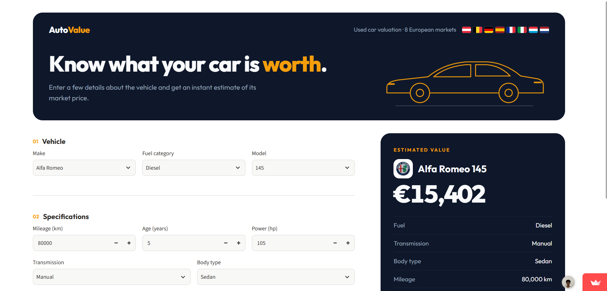

# AutoValue — Car Price Prediction

AutoValue is an end-to-end Machine Learning project that predicts used car listing prices based on vehicle characteristics.

The project covers data exploration, preprocessing, model training, evaluation, and deployment through an interactive web application built with Streamlit.

### [Try AutoValue Live](https://autovalue-car-price-prediction-eu.streamlit.app/)

## Project Overview

The goal of AutoValue is to estimate the price of a used car using information such as its brand, model, mileage, age, engine power, and fuel type.

The application supports **8 European countries** and generates predictions using a trained CatBoost regression model.

## Dataset

The original dataset contained approximately **118,000 used car listings** from European markets.

After data cleaning and preprocessing, **108,273 records** were retained.

The model uses the following features:

- Brand and model
- Mileage
- Vehicle age
- Engine power (hp)
- Fuel type
- Transmission
- Body type
- Country

The target variable is the advertised vehicle price in euros.

## Machine Learning Models

Several regression models were evaluated during development:

- Dummy Regressor
- Linear Regression
- Random Forest Regressor
- CatBoost Regressor

**CatBoost** was selected as the final model based on its performance on the test dataset.

### Final Model Performance

| Metric | Result |
|---|---:|
| MAE | €5,686.50 |
| RMSE | €30,342.40 |
| R² | 0.9218 |

The model was trained on **86,618 records** and evaluated on **21,655 test records**.

## Application

AutoValue provides an interactive interface where users can:

- Select a vehicle's brand and model.
- Enter mileage, age, and engine power.
- Choose fuel type, transmission, and body type.
- Select one of eight European markets.
- Obtain an estimated price in euros.

### Application Preview



**[Open the Live Application](https://autovalue-car-price-prediction-eu.streamlit.app/)**

## Project Structure

```text
car-price-prediction/
├── config/
│   └── valid_categories.json
├── data/
│   └── processed/
│       └── cars_clean.csv
├── models/
│   └── catboost_final.joblib
├── notebooks/
│   ├── 01_exploratory_analysis.ipynb
│   ├── 02_data_preprocessing.ipynb
│   └── 03_model_training.ipynb
├── src/
│   ├── __init__.py
│   ├── app.py
│   ├── main.py
│   ├── predict.py
│   └── validation.py
├── tests/
├── requirements.txt
└── README.md
```

## Technologies Used

- **Python** — Programming language
- **Pandas and NumPy** — Data processing
- **Matplotlib** — Data visualization
- **Scikit-learn** — Machine Learning and evaluation
- **CatBoost** — Final prediction model
- **Streamlit** — Web application
- **Jupyter Notebook** — Data analysis and experimentation
- **Git and GitHub** — Version control

## Installation

Clone the repository:

```bash
git clone https://github.com/FranciscoVieira10/car-price-prediction.git
cd car-price-prediction
```

Install dependencies:

```bash
pip install -r requirements.txt
```

Download the trained model using Git LFS (requires Git LFS to be installed):

```bash
git lfs install
git lfs pull
```

Run the Streamlit application:

```bash
python -m streamlit run src/app.py
```

Alternatively, run the command-line version:

```bash
python -m src.main
```

## Testing

Run the automated tests with:

```bash
python -m unittest discover -s tests -v
```

The project includes **11 automated tests** covering input validation, vehicle categories, and prediction behaviour.

## Limitations

- Predictions represent estimated advertised prices, not guaranteed selling prices.
- Accuracy may vary for rare, luxury, or unusually expensive vehicles.
- Estimates depend on the quality and representativeness of the training data.
- Market prices may change over time.

## Deployment

AutoValue is deployed using Streamlit Community Cloud.

**Live Demo:** https://autovalue-car-price-prediction-eu.streamlit.app/